  

  
  
  
  
  
  
  

---

# 🛡️ Awesome Smart Contract Flaw Verification Tools

> 🔍 **A comprehensive, SEO-optimized curated directory of enterprise SaaS platforms, automated vulnerability scanners, formal verification engines, fuzzers, and open-source static analyzers for Ethereum (EVM) and multi-chain smart contracts.**

Smart contract vulnerabilities cost the Web3 ecosystem billions in lost capital annually. Flaw verification bridges automated compiler checks, formal mathematical proofs, static abstract interpretation, property-based fuzz testing, and continuous runtime exploit monitoring to uncover reentrancy, access control bypasses, integer flaws, and business-logic bugs before deployment.

---

## 📑 Table of Contents

- [🌐 Sector Overview & Market Dynamics](#-sector-overview--market-dynamics)
- [🏢 SaaS & Hosted Security Platforms](#-saas--hosted-security-platforms)
- [🔓 Open-Source Verification Projects](#-open-source-verification-projects)
- [🧠 Verification Methodologies & Tool Taxonomy](#-verification-methodologies--tool-taxonomy)
- [🤝 How to Contribute](#-how-to-contribute)
- [📈 Star History](#-star-history)
- [☕ Support & Community](#-support--community)
- [⚖️ Disclaimer](#️-disclaimer)

---

## 🌐 Sector Overview & Market Dynamics

The global smart contract security, auditing, and flaw verification market is currently valued between **$2.6 billion and $3.4 billion**, with industry projections forecasting rapid growth to over **$7.5 billion by 2030** (advancing at a CAGR of ~25%–30%). This surge is catalyzed by institutional real-world asset (RWA) tokenization, stricter global regulatory regimes such as the European Union's MiCA framework, and the critical need to protect hundreds of billions in decentralized finance (DeFi) total value locked (TVL).

Rather than functioning as a "winner-take-all" monopolistic arena, the sector remains **moderately to highly fragmented**. High-stakes protocols and Web3 enterprises deliberately avoid single-vendor dependency. Instead, security teams employ defense-in-depth strategies combining multiple independent manual audit firms, automated CI/CD static scanners, continuous fuzzing pipelines, crowdsourced whitehat bug bounty networks (such as Immunefi and Sherlock), and decentralized runtime telemetry feeds.

---

## 🏢 SaaS & Hosted Security Platforms

The following hosted solutions provide automated continuous scanning, bug bounty orchestration, managed formal verification, and manual code audits. Platforms are sorted **descending by company size** (market valuation and annual recurring revenue).

| 🏢 Platform | 📊 Company Size (Valuation / ARR) | 💳 Starting Tier Pricing | 🎁 Free Tier Limits | 🛡️ Key Capabilities & Focus |
| :--- | :--- | :--- | :--- | :--- |
| **[ConsenSys Diligence](https://diligence.security/)** | **$7.0 Billion Valuation** (~$150M ARR) | **$300/month** (Builder Fuzzing SaaS; manual audits from $30,000) | **Explorer Plan ($0 forever)**: 100 fuzzing campaigns/month with a 5-minute maximum execution time per campaign | Fuzzing-as-a-Service (FaaS) for Solidity/Foundry contracts, automated invariant testing, and tier-1 Ethereum manual audit advisory. |
| **[CertiK](https://www.certik.com/)** | **$2.0 Billion Valuation** (~$90M ARR) | **$500/month** (Skynet Pro SaaS; manual audits from $8,000 for standard ERC-20s) | **Community Explorer ($0 forever)**: Unlimited public access to Skynet project security leaderboards, risk radar, and token scam alerts (0 free manual audits) | On-chain runtime monitoring (Skynet), formal verification, high-volume audits, KYC team verification, and exchange listing compliance. |
| **[Immunefi](https://immunefi.com/)** | **$500 Million Valuation** (~$20M ARR) | **10% payout commission** on open bounty payouts, or **$15,000/year** flat BBP subscription | **Researcher & Open Directory ($0 forever)**: Free project browsing, 650+ bug bounties, vulnerability submissions, and self-managed open bounty listing ($0 upfront listing fee) | Premier Web3 bug bounty marketplace with $110M+ paid out, managed vulnerability triage, and V2.2 severity classification standard. |
| **[Halborn](https://www.halborn.com/)** | **$300M – $500M Valuation** (~$10M+ ARR) | **$40,000** starting engagement fee for single-contract security audits ($100,000+ for multi-contract protocols) | **Free 30-Minute Threat Modeling Review**: Complimentary introductory architectural risk consultation & free public advisory reports (0 free manual audits) | Offensive security, Layer 1 protocol audits, full-stack penetration testing, and continuous DevSecOps advisory. |
| **[OpenZeppelin](https://www.openzeppelin.com/)** | **$150M – $250M Valuation** (Acquired by S&P Global; $12.7M ARR) | **$500/month** (historical Defender Team plan; custom enterprise audits start at $30,000) | **Community Tier ($0 forever)**: 5 smart contracts monitored, 1 user seat, 20 sentinels, 500 watched transactions/hour, and free open-source contract libraries (0 free manual audits) | Industry reference EVM audits, automated operational security (Defender), automated relayers, and secure upgrade governance. |
| **[Quantstamp](https://quantstamp.com/)** | **$100M – $150M Valuation** (~$18M ARR) | **$14,000** starting tier for token & small contract audits ($42,000–$50,000 for standard DeFi protocols) | **Free Pre-Audit Structural Scan**: Complimentary automated codebase parsing and scoping intake assessment (0 free formal verification audits) | Mathematical formal verification, protocol logic proofs, Layer-1/Layer-2 audits, and white-glove security advisory. |
| **[Trail of Bits](https://www.trailofbits.com/)** | **$100M – $120M Valuation** (~$15.6M ARR) | **$25,000/engineer-week** (typical audit engagements start at $40,000–$50,000 for 1–2 weeks) | **Free Open-Source Security Suite ($0 forever)**: 100% free unlimited access to industry-standard tools (Slither, Echidna, Medusa) (0 free proprietary manual audit days) | Boutique research firm specializing in zero-knowledge (ZK) circuits, novel cryptographic primitives, compilers, and low-level execution engines. |
| **[Hacken](https://hacken.io/)** | **$80M – $120M Valuation** (~$12M ARR) | **$5,000** starting tier for ERC-20 / basic token contract audits ($10,000–$25,000 for DeFi vaults) | **Free Community Tier ($0 forever)**: CER.live exchange & token security ratings, HackenProof whitehat portal, and 15-minute scoping triage (0 free manual audits) | Dual-pass manual audits, crowdsourced vulnerability programs (HackenProof), on-chain threat monitoring, and tokenomics validation. |
| **[PeckShield](https://peckshield.com/)** | **$50M – $80M Valuation** (~$10M ARR) | **$5,000** entry price for simple contract checks ($20,000–$60,000 for standard DeFi systems) | **Community Threat Feed ($0 forever)**: Free real-time PeckShieldAlert Telegram channel, exploit post-mortems, and scam/drainer notices (0 free manual audits) | Rapid post-exploit threat intelligence, DeFi security audits, exchange monitoring, and attack vector forensics. |
| **[SolidityScan](https://solidityscan.com/)** | **$15M – $25M Valuation** (~$2M ARR) | **$199.99/month** (Individual tier up to 8,000 LOC) or **$29.99** per on-demand scan | **Free Trial (2 Scans / $0)**: 2 free automated vulnerability scans upon registration for contracts up to 1,000 LOC each | Cloud-native automated static analysis scanner with 160+ vulnerability detectors, CI/CD integrations, and instant web reports. |

---

## 🔓 Open-Source Verification Projects

A curated collection of self-hosted, open-source static analyzers, formal verification engines, property-based fuzzers, and bytecode evaluators. Sorted **descending by GitHub star count**.

* **[OpenZeppelin Contracts](https://github.com/OpenZeppelin/openzeppelin-contracts)**   
  The gold standard library for secure, audited Solidity development. Powers standard implementations for ERC-20, ERC-721, ERC-1155, access control (Ownable, AccessControl), reentrancy guards, and upgradeable contracts.

* **[Foundry](https://github.com/foundry-rs/foundry)**   
  Blazingly fast, portable, and modular Ethereum development and testing framework written in Rust. Features native property fuzzing, symbolic execution hooks, differential testing, and gas profiling via `forge`, `cast`, and `anvil`.

* **[Slither](https://github.com/crytic/slither)**   
  Trail of Bits' industry-standard static analysis framework for Solidity. Converts Solidity AST to intermediate representation (SlithIR) to run 80+ detectors flagging reentrancy, uninitialized state, and authorization flaws with near-instant speed.

* **[Mythril](https://github.com/ConsenSysDiligence/mythril)**   
  ConsenSys Diligence's symbolic execution and concolic analysis security scanner for EVM bytecode. Discovers edge-case vulnerabilities by generating constraint models using the Z3 SMT solver.

* **[Manticore](https://github.com/trailofbits/manticore)**   
  Symbolic execution tool for the analysis of smart contracts and binaries by Trail of Bits. Explores contract state spaces symbolically to mathematically verify invariants and uncover complex execution paths.

* **[Echidna](https://github.com/crytic/echidna)**   
  Trail of Bits' property-based fuzzer for Ethereum smart contracts. Uses grammar-based mutation and coverage feedback to falsify user-defined invariants and break protocol assumptions.

* **[Building Secure Contracts](https://github.com/crytic/building-secure-contracts)**   
  Trail of Bits' definitive repository of security guidelines, common vulnerability checklists, testing recipes, and static analysis configurations for Web3 engineers.

* **[hevm (dapptools)](https://github.com/dapphub/dapptools)**   
  EVM implementation specifically crafted for symbolic execution, property testing, and contract equivalence verification. Serves as a foundation for formal EVM semantic checking.

* **[Weird ERC20 Tokens](https://github.com/d-xo/weird-erc20)**   
  Comprehensive catalog of non-standard ERC-20 token behaviors (rebasing tokens, fee-on-transfer, missing return values, flash-mintable) that frequently cause critical security bugs in DeFi protocols.

* **[EVM Opcodes](https://github.com/crytic/evm-opcodes)**   
  Interactive and detailed technical reference of Ethereum Virtual Machine (EVM) opcodes, execution gas costs, and memory/stack layouts maintained by Crytic.

* **[Surya](https://github.com/ConsenSysDiligence/surya)**   
  ConsenSys Diligence's architectural exploration and visualization utility. Generates function call graphs, inheritance trees, control flows, and contract interaction matrices for smart contract audits.

* **[Solhint](https://github.com/protofire/solhint)**   
  Open-source Solidity linter providing automated style guide rules and security vulnerability warnings (such as dangerous assembly usage, tx.origin, and reentrancy anti-patterns).

* **[Halmos](https://github.com/a16z/halmos)**   
  a16z's symbolic testing tool that directly consumes standard Foundry unit tests as formal mathematical specifications. Translates EVM bytecode into Z3 logic formulas without learning a separate specification language.

* **[Solgraph](https://github.com/raineorshine/solgraph)**   
  Generates DOT visual graphs of Solidity contract control flow, visually highlighting functions with state mutability vulnerabilities and untrusted external calls.

* **[solc-select](https://github.com/crytic/solc-select)**   
  CLI tool to instantly switch between any historical or cutting-edge Solidity compiler version without manual compilation. An essential asset for running legacy smart contract verification suites.

* **[Aderyn](https://github.com/Cyfrin/aderyn)**   
  Cyfrin's ultra-fast Rust-based Solidity static analyzer. Traverses the Abstract Syntax Tree (AST) to uncover protocol-level anti-patterns, security vulnerabilities, and gas inefficiencies.

* **[SmartBugs](https://github.com/smartbugs/smartbugs)**   
  Reproducible execution and benchmarking framework that orchestrates multiple smart contract analysis tools (including Slither, Mythril, HoneyBadger, and Oyente) across curated datasets.

* **[Securify2](https://github.com/eth-sri/securify2)**   
  Security scanner for Ethereum smart contracts developed by the ICE Center at ETH Zurich. Utilizes Datalog semantic patterns to rigorously prove compliance against severe vulnerability classes.

* **[KEVM (EVM Semantics)](https://github.com/runtimeverification/evm-semantics)**   
  Formal, mathematically validated specification of Ethereum Virtual Machine (EVM) bytecode written in the K Framework. Forms the theoretical foundation for high-assurance formal verification.

* **[ESBMC](https://github.com/esbmc/esbmc)**   
  Permissively licensed SMT-based bounded model checker supporting Solidity. Mathematically proves the absence of runtime bugs (overflows, memory corruption, bounds violations) and verifies user-defined assertions.

* **[Medusa](https://github.com/crytic/medusa)**   
  Cross-platform, Go-ethereum-based fuzzer inspired by Echidna. Features parallelized fuzz testing across multiple workers with coverage-guided mutation and custom testing APIs.

* **[pyevmasm](https://github.com/crytic/pyevmasm)**   
  Python EVM Assembler and Disassembler with CLI and library support. Used by security auditors to inspect and mutate raw contract bytecode.

* **[Scribble](https://github.com/ConsenSysDiligence/scribble)**   
  ConsenSys Diligence's specification language and instrumentation tool that transforms high-level contract specifications into concrete runtime assertions directly inside Solidity code.

* **[Kontrol](https://github.com/runtimeverification/kontrol)**   
  Runtime Verification's formal verification engine integrating Foundry tests with KEVM. Mathematically proves that EVM bytecode executions adhere strictly to formal specifications.

* **[EVM Fuzz (Spamoor)](https://github.com/ethpandaops/spamoor)**   
  Spams randomly generated EVM bytecode onto chains to uncover consensus bugs, client crashes, and opcode edge-case regressions under extreme stress loads.

* **[AI Smart Contract Auditor](https://github.com/iktok90-design/ai-smart-contract-auditor)**   
  AI-augmented auditing engine backed by a database of 47,000+ historical audit findings and 300,000+ PoCs. Employs ChromaDB vector search to synthesize automated exploit proofs.

* **[MIESC](https://github.com/fboiero/MIESC)**   
  Multi-layer Intelligent Evaluation for Smart Contracts orchestrating 30+ security tools across 9 defense layers (Static, Dynamic, Symbolic, Formal, AI, Threat Modeling, and Ensembles).

---

## 🧠 Verification Methodologies & Tool Taxonomy

| 🔬 Methodology | 🎯 Primary Objective | ⚡ Representative Tools | 💡 Key Strengths & Trade-offs |
| :--- | :--- | :--- | :--- |
| **Static Analysis** | Scan AST & control flow for known anti-patterns without executing code. | **Slither**, **Aderyn**, **Solhint**, **SolidityScan** | 🟢 Extremely fast; zero runtime setup. 🔴 Higher false-positive rates; blind to dynamic state bugs. |
| **Property-Based Fuzzing** | Generate millions of pseudo-random inputs to break contract invariants. | **Foundry (`forge test`)**, **Echidna**, **Medusa** | 🟢 Discovers unexpected edge cases and state sequences. 🔴 Requires writing precise invariants; cannot prove complete absence of bugs. |
| **Symbolic Execution** | Evaluate code using algebraic symbols and SMT solvers to test all possible execution paths. | **Mythril**, **Halmos**, **Manticore**, **hevm** | 🟢 Mathematical verification of path reaches; generates reproducible PoCs. 🔴 Susceptible to state-space explosion on deep loops. |
| **Formal Verification** | Mathematically prove contract behavior satisfies a formal specification. | **Kontrol (KEVM)**, **ESBMC**, **Quantstamp** | 🟢 Absolute mathematical certainty against modeled properties. 🔴 Computationally expensive; requires high specification expertise. |
| **Runtime Monitoring** | Inspect live transactions and block state to intercept exploits in flight. | **CertiK Skynet**, **OpenZeppelin Defender**, **PeckShieldAlert** | 🟢 Protects already-deployed protocols; triggers automated pauses. 🔴 Cannot fix vulnerable contract bytecode post-deployment. |

---

## 🤝 How to Contribute

Contributions are welcome from the entire Web3 and cybersecurity community! To suggest a new tool or update an existing entry:

1. 🍴 **Fork the repository** to your GitHub account.
2. 🌿 **Create a feature branch** (`git checkout -b feature/add-new-verification-tool`).
3. ✍️ **Update `README.md`**:
   - Follow the existing tabular structure for SaaS tools (include valuation/ARR, specific starting price, and concrete free tier limits).
   - For open-source tools, include the repository URL, stargazers social badge, and place it in the correct position according to star count.
4. 🚀 **Commit your changes** with a clear message (`git commit -m 'feat: add NewTool to open-source verification list'`).
5. 📬 **Submit a Pull Request** describing the platform's verification methodology and features.

---

## 📈 Star History

---

## ☕ Support & Community

Thank you for visiting **Awesome Smart Contract Flaw Verification Tools**! If this repository has helped your security research, protocol audit workflow, or smart contract development:

- ⭐ **Star this repository** to help other developers discover it!
- 🍴 **Fork and share** it with your security team and Web3 community.
- 💬 **Join our community on [Discord](https://discord.gg/jc4xtF58Ve)** to discuss smart contract security findings, zero-day research, and verification frameworks.
- ☕ **Support the maintainer**: Buy a coffee or sponsor ongoing maintenance via the [GitHub Sponsors Dashboard](https://github.com/sponsors/ishandutta2007).

Your support enables continuous curation and updates for the global decentralized security ecosystem! 💙

---

## ⚖️ Disclaimer

- This directory is a **community-curated educational resource** — inclusion of any platform or tool does not constitute an endorsement, warranty, or security guarantee.
- Smart contracts operate in hostile, non-custodial environments. **No single audit or verification tool guarantees 100% exploit immunity**. True security requires a defense-in-depth posture comprising static analysis, invariant fuzzing, formal proofs, external human audits, multi-sig governance, and bug bounties.
- Always perform comprehensive local testing and independent reviews prior to deploying smart contracts handling user funds to public mainnets.
